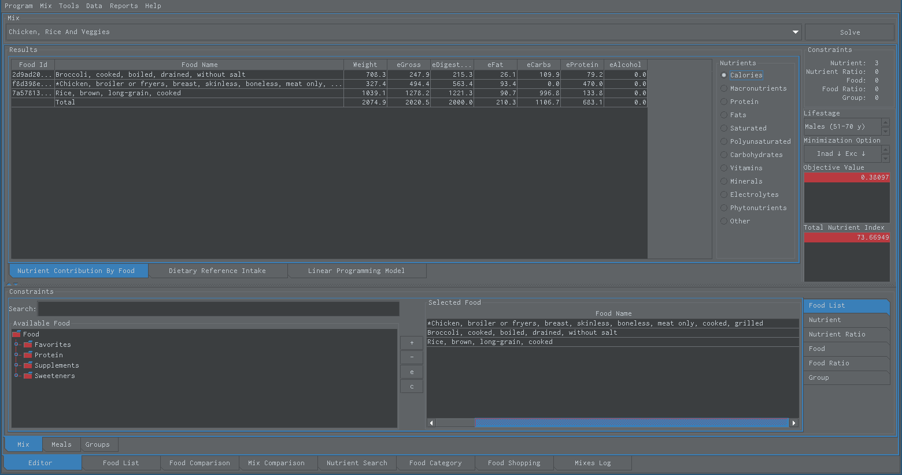

Projects
========

Snack Nutrition Software
------------------------

  Snack Nutrition Software is software for nutrition, a meal design tool and calculator used for understanding a person's food intake. Its intended audience is anyone with interest in nutrition. It is a software application that calculates and maximizes the nutritional value of food combinations. It minimizes both deficiency and excess of nutrients in your food selection to try to give you the best possible nourishment. It allows user to quickly, inexpensively and easily experiment with different food combinations that have specific dietary requirements. Snack's ultimate purpose is to empower its users to make better nutrition decisions that will their improve diet, nutrition, health and quality of life. Software can be downloaded and used for no money although author considers it priceless. Snack is now available to the whole world (7.674 billion people or 7674 million people).
 
  **You are invited.**

 
.. index:: Snack

   
   **Snack minimizes both the deficiency and the excess of calcium, magnesium, potassium, choline and vitamins A, C, D, E (TNI nutrients) and sodium in a food mixture. It also calculates its Total Nutrient Index (TNI) score.**

+------------------+---------------------------------------------------------------+
| Stable Release   |October 21, 2026                                               |
+------------------+---------------------------------------------------------------+
| Repository       |https://github.com/xjrga/snack                                 |
+------------------+---------------------------------------------------------------+
| YouTube          |https://www.youtube.com/@SnackSoftware                         |
+------------------+---------------------------------------------------------------+
| Twitter          |https://x.com/SnackSoftware                                    |
+------------------+---------------------------------------------------------------+
| Written in       |java                                                           |
+------------------+---------------------------------------------------------------+
| Type             |nutrition                                                      |
+------------------+---------------------------------------------------------------+
| License          |gpl2                                                           |
+------------------+---------------------------------------------------------------+
| Download         |`snack-1720.zip <../releases/snack-1720.zip>`_                 |
+------------------+---------------------------------------------------------------+
| Signature        |`snack-1720.zip.asc <../releases/snack-1720.zip.asc>`_         |
+------------------+---------------------------------------------------------------+
| Sources          |`snack-1720-sources.zip <../releases/snack-1720-sources.zip>`_ |
+------------------+---------------------------------------------------------------+

.. toctree::
   :maxdepth: 1

   See more<snack/index>
   
----

Author
------
.. index:: Author

.. toctree::
   :maxdepth: 1

   See more<author/index>
