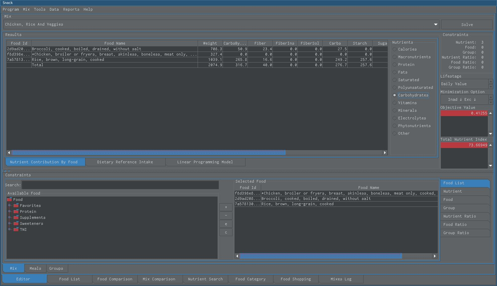

Snack Carbohydrates
===================

   Carbohydrates are your body's primary energy source, consisting of sugars, starches, and fiber. Sugars and starches break down into glucose to fuel your brain, muscles, and daily activities, while fiber is a nondigestible carbohydrate that keeps your digestive system functioning properly and it also helps your microbiome flourish.
