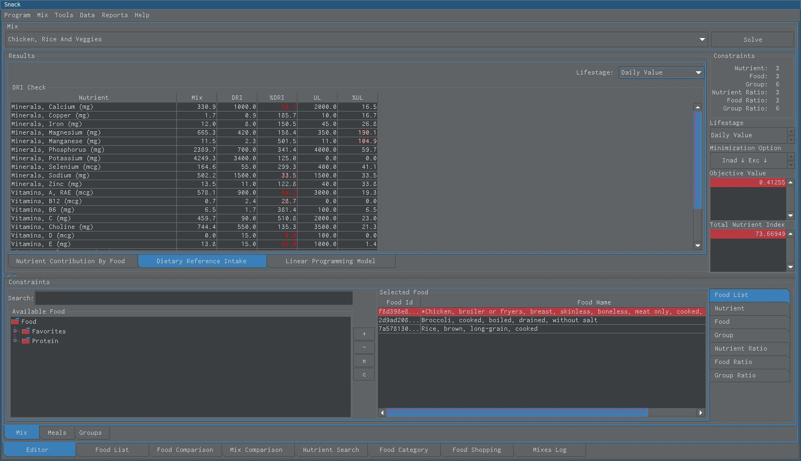
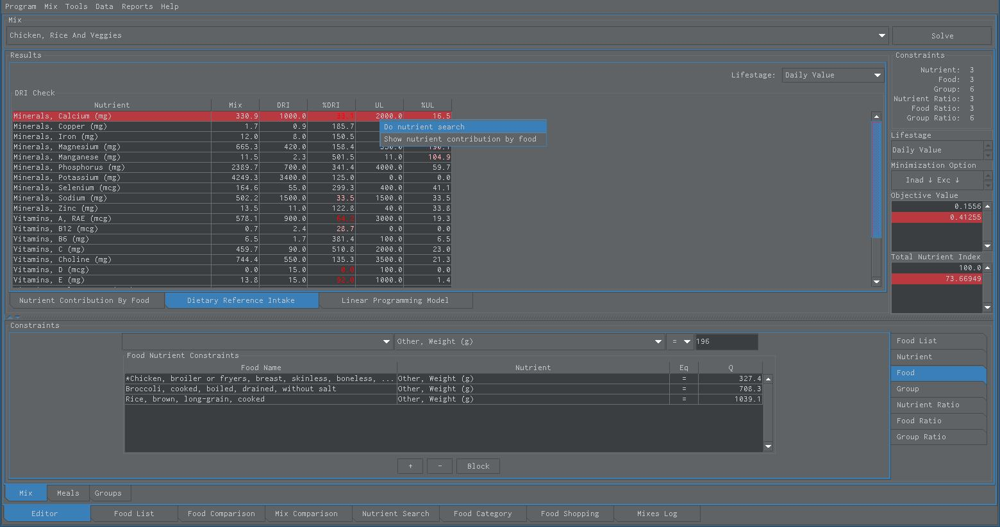
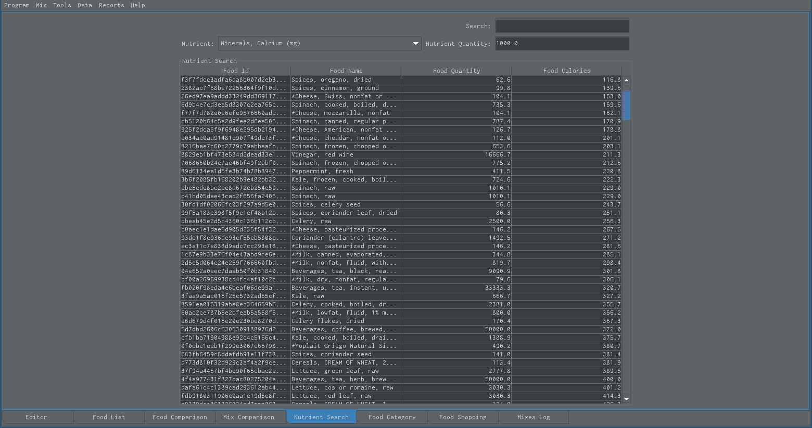

Snack Dietary Reference Intake
==============================

   This is the daily reference intake (DRI) summary view. Dietary Reference Intakes (DRIs) are a comprehensive set of scientifically developed reference values issued by the Food and Nutrition Board of the National Academies of Sciences, Engineering, and Medicine. DRIs provide quantitative estimates of nutrient intakes used to plan and assess diets for healthy people, moving beyond traditional focus on preventing deficiency diseases to supporting long-term health and reducing chronic disease risk.
     
   The pink and red numbers are nutrient deficiencies at the Percent of DRI (%DRI) column. The red numbers are part of the total nutrient index (TNI). 

-----

   When looking at the daily reference intake we may ask ourselves how we can meet those requirements. If you right click on one of those nutrients you can get list of food items that provide it. 
   
-----

   Here is list of food items that provide calcium. 
   