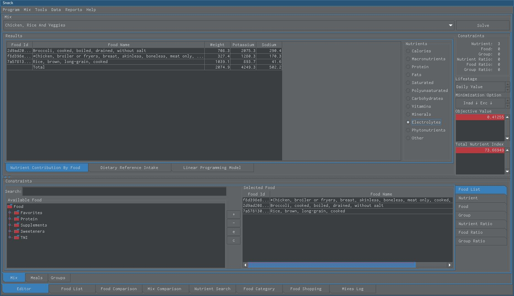

Snack Electrolytes
==================

   This is the electrolytes summary view. Sodium and potassium are essential electrolytes that work together to regulate fluid balance, blood volume, nerve signals, muscle contractions, and blood pressure. Most people consume too much sodium and too little potassium, which can raise blood pressure and increase the risk of heart disease and stroke.