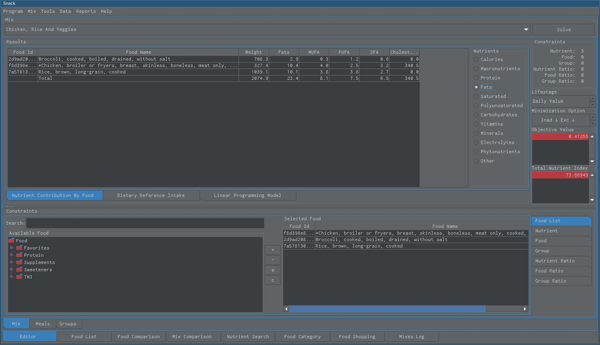

Snack Fats
==========

   This is the fats summary view. MUFA, PUFA and SFA are the three main dietary fatty acid classes and each plays distinct roles in nutrition. MUFA is monounsaturated fatty acids. PUFA is polyunsaturated fatty acids and SFA is saturated fatty acids.