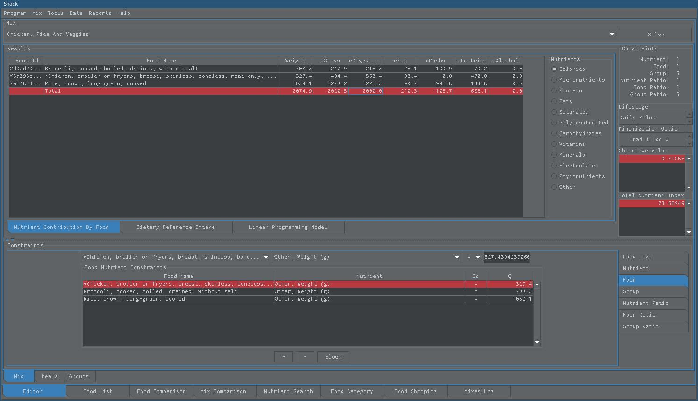

Snack Food Constraint
=====================

   The food constraint is used to put specify a limit on a specific food item in the snack mix. This is a special case of the group constraint where only one food item participates.