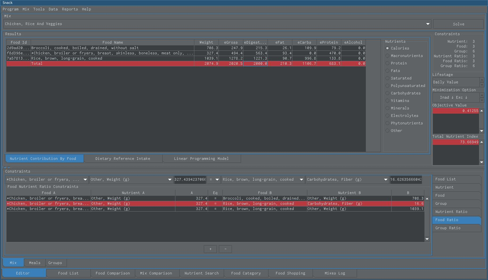

Snack Food Ratio Constraints
============================

   The food ratio constraint is used to establish a proportional relationship between two food items. This is a special case of the group constraint ratio where only two food items participate.
