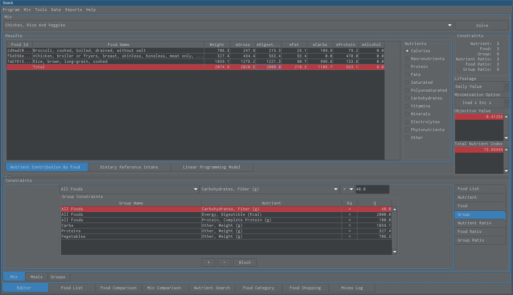

Snack Group Constraints
=======================

   The group constraint is used to specify a limit on one or more food items. This type of constraint is typically used when we need to specify a limit on two or more items but less than all. Some of the constraints shown here are redundant and are only shown for demonstration purposes.