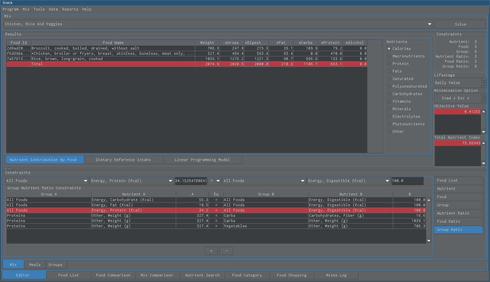

Snack Group Ratio Constraints
=============================

   The group ratio constraint is used to establish a proportional relationship between two groups of one or more food items. This type of constraint is typically used when we need to specify a limit on two or more items but less than all. Some of the constraints shown here are redundant and are only shown for demonstration purposes.
