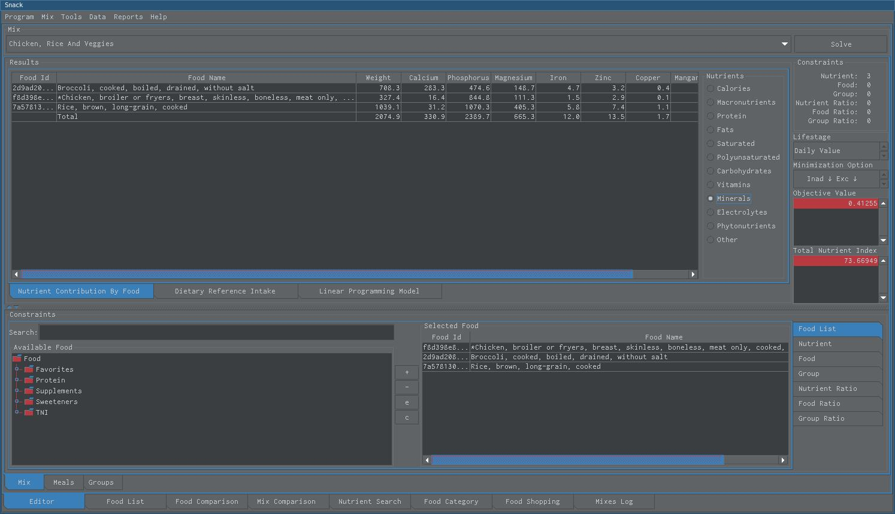

Snack Minerals
==============

   This is the minerals index summary view. Dietary minerals are essential inorganic nutrients that build structural tissues, regulate fluids and nerves, drive enzyme and hormone activity, and support immunity and metabolism.