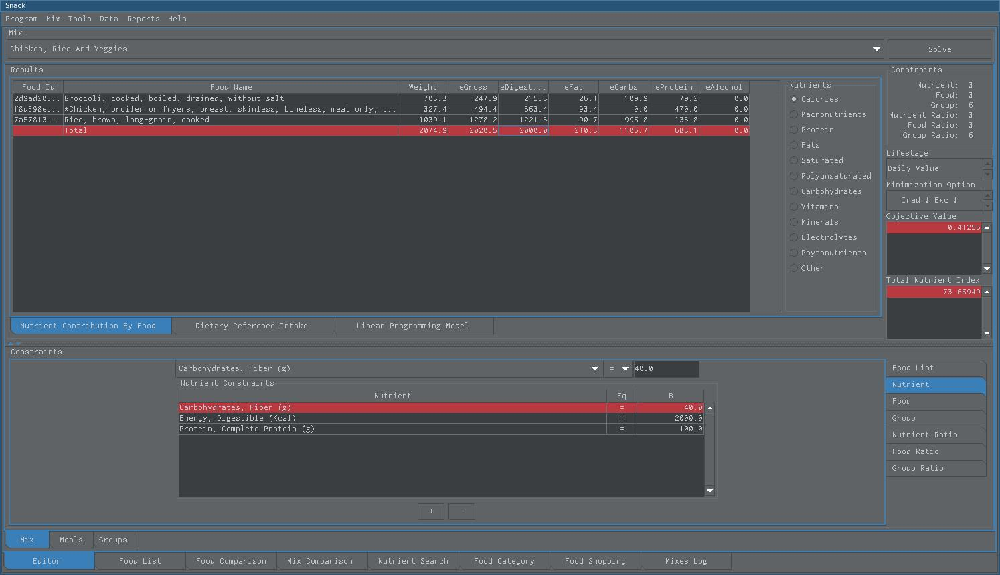

Snack Nutrient Constraints
==========================

   The nutrient constraint is used to put specify a limit on a specific nutrient in the snack mix. This is a special case of the group constraint where all food items participate.
