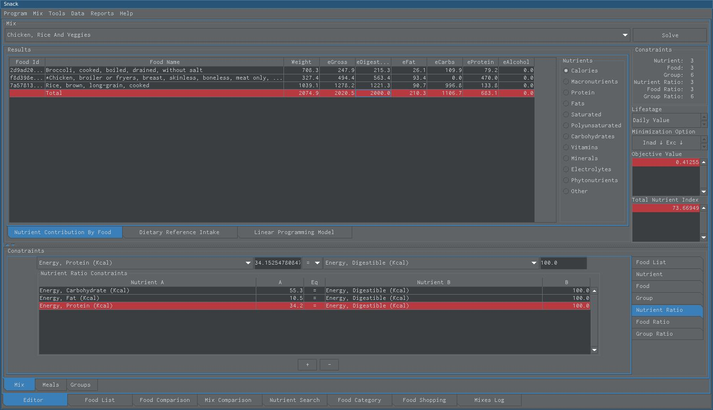

Snack Nutrient Ratio Constraints
================================

   The nutrient ratio constraint is used to establish a proportional relationship between two nutrients. This is a special case of the group constraint ratio where all food items participate.
