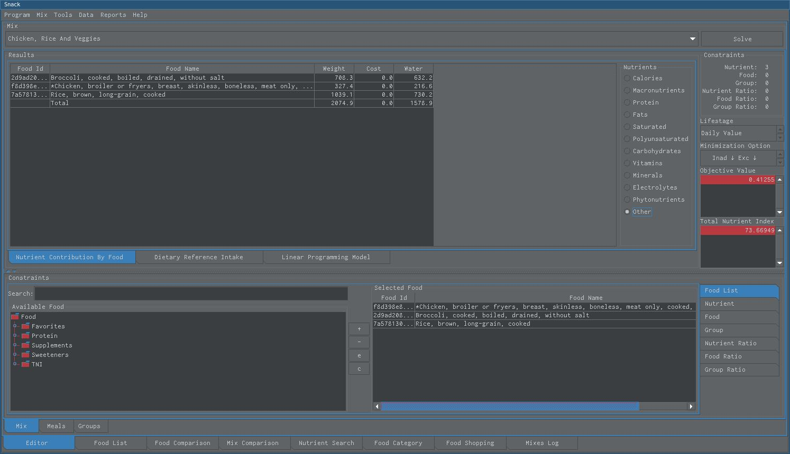

Snack Cost And Water
====================

   This is the water summary view. Water makes up about 60% of the human body and is necessary to power cells, transport nutrients, and flush out waste.  Staying properly hydrated prevents dehydration, keeps your organs working smoothly, and supports your overall physical and mental health.