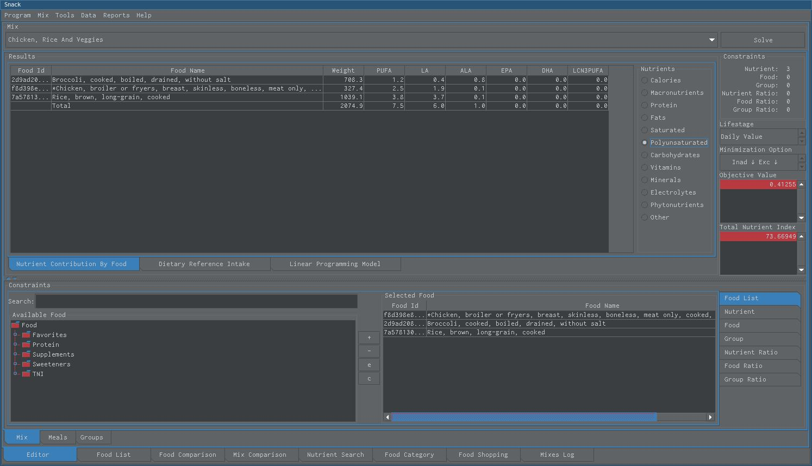

Snack Polyunsaturated Fat
=========================

   This is the polyunsaturated fat summary view. It is recommended to replace saturated fats with unsaturated fats—especially polyunsaturated fats—to lower LDL ("bad") cholesterol and cardiovascular disease risk. Essential fatty acids are specific polyunsaturated fats—linoleic acid (omega-6) and alpha-linolenic acid (ALA) (omega-3)—that your body cannot make on its own and must get from food. They play vital roles in cell membrane structure, inflammation regulation, brain and eye health, and energy production. There are also long-chain omega-3 fatty acids which support heart health, help lower triglycerides, and assist in managing inflammation and are critical for infant and child neurodevelopment, vision, and cognitive function.