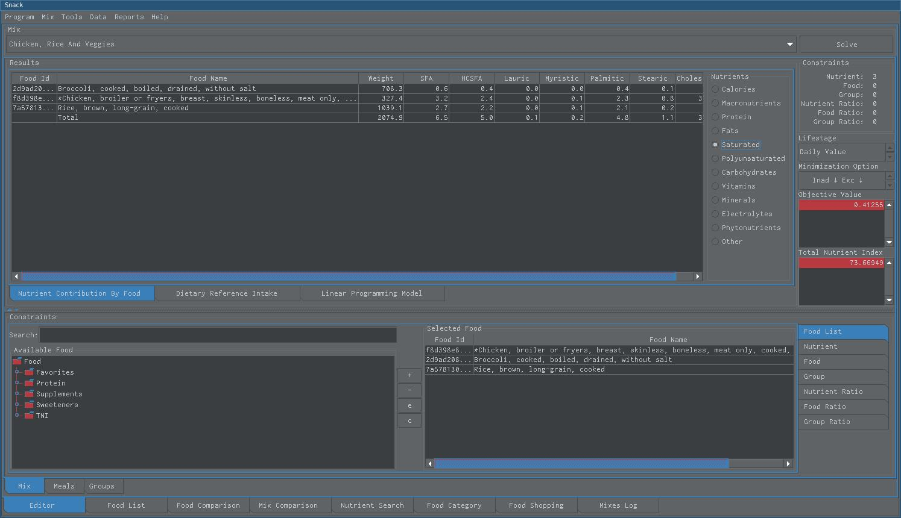

Snack Saturated Fat
===================

   
   This is the saturated fat summary view. A high intake of saturated fat raises levels of LDL (bad) cholesterol in the blood and an elevated LDL cholesterol is linked to an increased risk of heart disease and stroke. That is why is recommended to limit its intake.