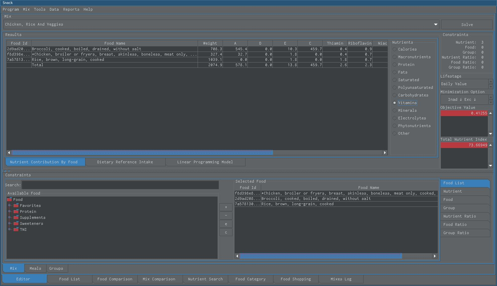

Snack Vitamins
==============

   Vitamins are essential organic micronutrients that help your body convert food into energy, build and repair tissues, support immune function, and regulate nerve and organ activity. There are fat-soluble and water-soluble vitamins.